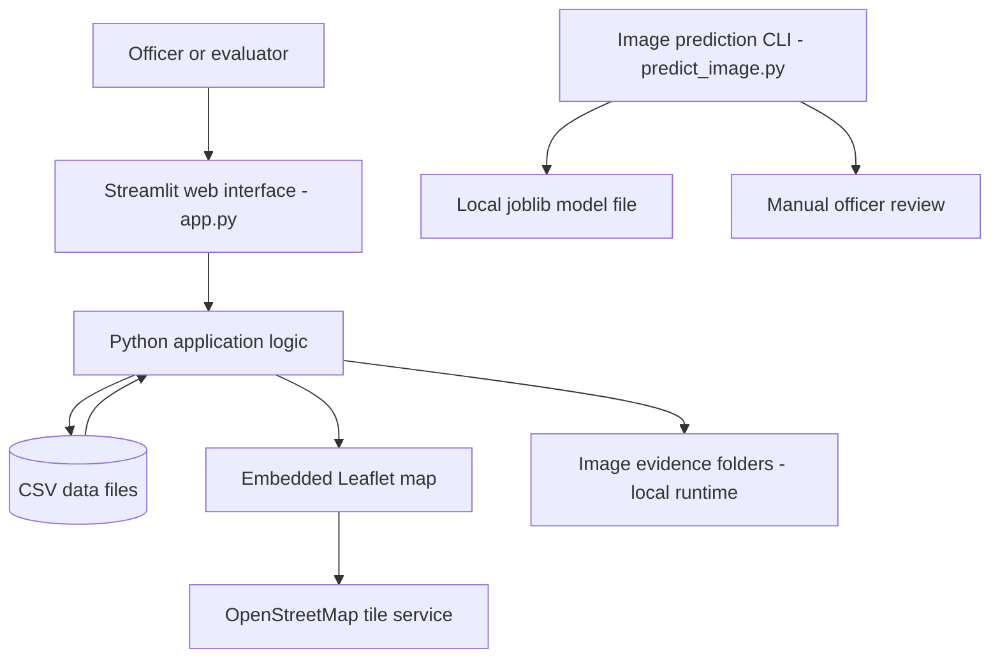

# Technical Design Document — Karuvelam 360

**Project:** Karuvelam360 – Prosopis Juliflora Management Platform  
**Team:** Karuvelam 360  
**Competition context:** Hack for Social Cause (HSC), VBYLD 2027  
**Repository:** https://github.com/sabhiroopa/PDL-Project

## 1. Purpose and scope

Karuvelam 360 is a student prototype for recording and monitoring sites affected by invasive *Prosopis Juliflora*. It demonstrates how structured site records, a map interface, clearance records, monitoring information, alerts, and basic reporting can be brought together in one application.

This document describes the architecture visible in the current source repository. It distinguishes implemented prototype components from experimental or future work; it does not claim that the system has been field-validated.

## 2. High-level architecture



The Streamlit app reads local CSV files and renders the interface. The map is generated as HTML using Leaflet, with map tiles served by OpenStreetMap. The separate image prediction script expects a model artifact on disk; that artifact is not currently included in the public repository.

## 3. Technology stack

| Layer | Technology | Role in the prototype |
|---|---|---|
| User interface | Streamlit | Renders the browser-based application and its controls |
| Application logic | Python | Implements data initialization, loading, processing, and workflow logic |
| Tabular data | Pandas and CSV | Reads and writes local records |
| Geographic display | Leaflet and OpenStreetMap | Displays site points using latitude and longitude from the site records |
| Geographic file format | GeoJSON | A file path exists in the repository, but the current GeoJSON file is empty and is not usable as a district boundary dataset |
| Image processing | Pillow, NumPy, scikit-image | Used by the separate image prediction script to load images and extract features |
| Classification | scikit-learn and joblib | The prediction script expects a saved classifier pipeline/artifact |

## 4. Application components

### 4.1 Site management

The main site records are stored in `data/sites.csv`. Fields include site ID, district, taluk, village, coordinates, area, infestation level, risk, status, clearance method, budget values, biomass, clearance date, officer/remarks fields, image paths, and image verification fields.

When the expected CSV files do not exist, the app initializes them with prototype sample records or empty tables containing the expected columns. Records are local-file based, not stored in a central database.

### 4.2 Monitoring and alerts

The repository contains separate CSV files for monitoring inspections, schemes, links between project sites and schemes, alerts, and alert actions:

- `data/monitoring.csv`
- `data/schemes.csv`
- `data/project_sites.csv`
- `data/alerts.csv`
- `data/alert_actions.csv`

These files establish the prototype's data structure for tracking follow-up work. The content is demonstration/sample data and should not be interpreted as verified government records.

### 4.3 GIS map

The map HTML is generated from the site table. Each valid row with coordinates can appear as a circle marker, with marker colour based on the recorded risk level. A popup presents site ID, district, taluk, village, infestation, risk, and status. The map is centred on Tamil Nadu and loads Leaflet assets and OpenStreetMap tiles from external URLs, so an internet connection is needed for those map resources.

The current `data/tamil_nadu_districts.geojson` file is zero bytes. The current map uses site coordinates; it should not be described as displaying district boundaries until valid boundary data is added and tested.

### 4.4 Image verification prototype

`models/predict_image.py` is a command-line script for an experimental image classifier. It extracts HOG and RGB histogram features and expects `models/prosopis_classifier.joblib` to exist locally. The model artifact and training script are not currently present in the public repository, so the prediction feature is **not reproducible from this repository alone**.

Any prediction score is not the same as validated test accuracy. The classifier has previously produced a false positive on a test image, so it must remain experimental. A responsible operator must verify images in the field; predictions must not be the sole basis for clearance action.

## 5. Data flow

1. On launch, the Streamlit application sets its page layout and resolves paths relative to the project folder.
2. It creates expected local data files if they are absent, with demonstration site rows and empty record tables as applicable.
3. Pandas loads the CSV tables into data frames.
4. The interface uses these data frames to render site workflows, summaries, and tables.
5. For map display, rows with parseable latitude and longitude are converted into Leaflet markers; selected site fields are shown in marker popups.
6. User changes are saved to the relevant local CSV files by the app's workflow code.
7. The separate image prediction script can be run from a terminal when a compatible trained model file is available; it outputs a tentative result that requires human review.

## 6. Repository layout

```text
PDL-Project/
├── app.py
├── README.md
├── requirements.txt
├── LICENSE
├── .gitignore
├── data/
│   ├── sites.csv
│   ├── monitoring.csv
│   ├── schemes.csv
│   ├── project_sites.csv
│   ├── alerts.csv
│   ├── alert_actions.csv
│   └── tamil_nadu_districts.geojson
└── models/
    └── predict_image.py
```

This tree reflects the files currently visible in the public repository. Local image evidence, the training script, the dataset, and the generated classifier artifact are not currently tracked in the repository.

## 7. Setup and execution

### Prerequisites

- Python 3.12 is the recommended version for the team's current development environment.
- Git is required to clone the repository.
- An internet connection is required to load the external Leaflet assets and OpenStreetMap tiles.

### Install and run

```bash
git clone https://github.com/sabhiroopa/PDL-Project.git
cd PDL-Project
python -m venv .venv
```

Activate the virtual environment:

**Windows PowerShell**
```powershell
.venv\Scripts\Activate.ps1
```

**macOS/Linux**
```bash
source .venv/bin/activate
```

Install packages and launch the app:

```bash
python -m pip install -r requirements.txt
python -m streamlit run app.py
```

The app will print a local URL in the terminal. Open that URL in a browser. The app uses local CSV files for persistence; this is a prototype setup, not a multi-user hosted database deployment.

### Environment variables

The current application source does not require any application-specific environment variables for its basic local run. Do not put passwords, API keys, access tokens, or personal credentials in the repository. If credentials or external integrations are added in a future version, configure them outside source control (for example, through local environment variables or Streamlit secrets).

## 8. Sample data and testing status

The CSV files in `data/` provide demonstration records and table schemas. Names such as “Demo Village” and “Demo Officer” are illustrative. Before submission, verify the data, clearly label all synthetic entries, and remove real personal or sensitive information.

There is no automated test suite in the current repository. Recommended first tests include:

1. **CSV initialization:** with data files absent, launching the app creates the expected CSV files and columns.
2. **Site data loading:** the sites CSV can be read and contains the expected fields.
3. **Map input validation:** invalid or missing coordinates are skipped rather than breaking map creation.
4. **Prediction input validation:** the prediction command reports a helpful error for a missing image or missing model artifact.
5. **Prediction safety:** any prediction is labelled as tentative and includes the need for human verification.

These are recommended test cases, not claims that automated tests already exist or have passed.

## 9. Known limitations and next steps

- CSV files are local storage; concurrent multi-user editing and production-grade access control are not provided.
- The district GeoJSON file is empty and must be replaced with valid, properly licensed boundary data if district polygons are required.
- No automated tests are currently included.
- The public repository currently lacks `models/train_ml_model.py`, a labelled image dataset, and the saved `prosopis_classifier.joblib` artifact. The classifier therefore cannot be trained or run from the public repository as-is.
- The image classifier is experimental and not validated for operational use.
- Map resources load from external services and require connectivity.
- Sample data and workflow results need field validation before real-world use.

Recommended improvements are to add automated tests, include safe and clearly labelled sample data, document the full reproducible model-training workflow (or remove claims of a reproducible AI module), add valid geographic data with its source/license, and evaluate the application with intended users before deployment.

## 10. Responsible AI and authorship disclosure

AI-assisted tools were used for some development support and documentation. The team should review every submitted file, confirm that it accurately represents the implementation, and disclose AI assistance and its estimated extent in the competition materials as required by the HSC guidelines. The team remains responsible for correctness, originality, licensing, and testing.

## 11. License

The repository includes an MIT License. Team members should ensure they agree to release the team's code under this license and that the team has permission to license all included code and assets.
